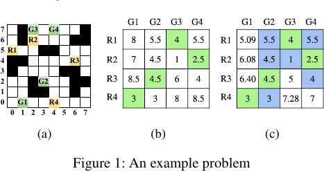
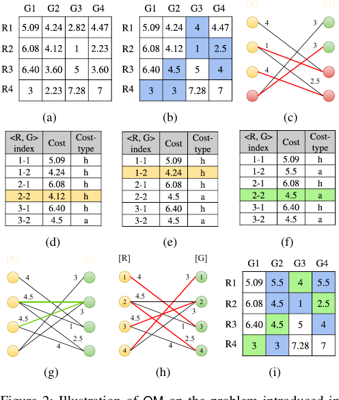
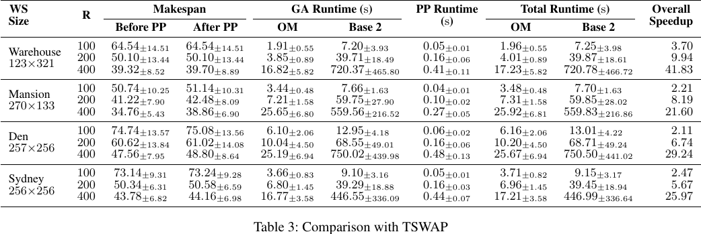

# Paper Review: Optimal Makespan in a Minute Timespan!

> **Paper:** Aakash and Indranil Saha, “Optimal Makespan in a Minute Timespan! A Scalable Multi-Robot Goal Assignment Algorithm for Minimizing Mission Time,” *AAAI 2024*, pp. 10280–10287.  
> **Links:** [Official paper page](https://ojs.aaai.org/index.php/AAAI/article/view/28894) · [DOI](https://doi.org/10.1609/aaai.v38i9.28894) · [Authors' implementation](https://github.com/iitkcpslab/H-Scalable-MRGA-Makespan.git)

## Reviews in this repository

- **OM / Optimal Makespan in a Minute Timespan:** this README
- **Hyper-SAMARL:** [Hypergraph-Based Coordinated Task Allocation and Socially-Aware Navigation](hyper-samarl-review.md)

## Short verdict

OM is a strong baseline for our project because it solves **one-shot, obstacle-aware goal assignment** for hundreds of robots while retaining exact optimality for its chosen objective. Its limitation is equally important: every robot–goal pair is evaluated independently, so the assignment does not anticipate congestion, path crossings, corridor competition, or collision-resolution delay.

> **OM solves the assignment computation problem very well, but it does not solve the interaction-aware assignment representation problem.**

## 1. What is the paper studying?

The paper considers robot start locations

$$S=\{s_1,\ldots,s_R\}$$

and goal locations

$$F=\{f_1,\ldots,f_G\}.$$

Each robot can receive at most one goal and each goal can be assigned to at most one robot. For robot $i$ and goal $j$, let

$$c_{ij}=\text{cost of an optimal obstacle-free path from }s_i\text{ to }f_j.$$

OM finds a matching $M$ that minimizes the largest assigned pair cost:

$$
M^*=\arg\min_M\max_{(i,j)\in M}c_{ij}.
$$

This is a **linear bottleneck assignment** objective. It balances the mission by reducing the distance or movement cost of the slowest/most expensive assigned robot.

The qualification is crucial: the paper defines $c_{ij}$ using an independently planned path and explicitly excludes the overhead of robot–robot collision avoidance from the assignment objective (paper, p. 10281).

## 2. How does it relate to our research direction?

Our research direction is **General Interaction-Aware Goal Assignment**. The central question is whether the assignment can anticipate the collective behavior that occurs after goals are assigned.

| OM | Our research direction |
|---|---|
| Scores each robot–goal pair independently | Scores an assignment as a collective configuration |
| Uses $c_{ij}$ | Needs a system-level cost $J_{\mathrm{system}}$ |
| Models static obstacles | Must also model robot–robot interaction |
| Resolves collisions after assignment | Tries to avoid harmful interaction during assignment |
| Optimizes independent-path makespan | Optimizes executed collective performance |
| Exact and highly scalable for its formulation | Seeks interaction awareness without losing practical scalability |

OM solves

$$
A_{\mathrm{OM}}=\arg\min_A\max_i c_{i,A(i)},
$$

while our target is closer to

$$
A_{\mathrm{ours}}
=\arg\min_A J_{\mathrm{system}}\!\left(A,\mathrm{Planner}(A),\mathcal E\right).
$$

OM should therefore be treated as a **high-quality pairwise baseline**, not as an interaction-aware solution.

## 3. What problem does OM improve?

The computational bottleneck is not only matching. It is obtaining the obstacle-aware cost matrix.

For $N$ robots and $N$ goals, there are $N^2$ possible pairs. At $N=400$:

$$400^2=160{,}000$$

shortest-path costs may need to be evaluated. Computing every exact $c_{ij}$ becomes expensive in large 2-D or 3-D workspaces.

OM improves this by asking:

> Which exact path costs must be known to prove the optimal bottleneck assignment?

It computes expensive paths only when they can affect the matching or the optimal makespan. The contribution is therefore **selective cost evaluation with an exact assignment guarantee**.

## 4. Main OM idea

OM maintains two cost types.

### H-cost: cheap lower bound

Initially, it uses Euclidean distance:

$$h_{ij}=\lVert s_i-f_j\rVert_2.$$

Since obstacles cannot make the true shortest path shorter,

$$h_{ij}\le c_{ij}.$$

Thus, $h_{ij}$ is an admissible lower bound.

### A-cost: exact path cost

When a pair becomes relevant, OM invokes Forward Resumable A* (FRA*) to obtain the exact obstacle-aware path cost:

$$a_{ij}=c_{ij}.$$

It selectively replaces $h_{ij}$ with $a_{ij}$ instead of calculating every $a_{ij}$ in advance.

**Figure 1 (reproduced from the paper, p. 10281).** Panel (a) gives the grid, robots, goals, and obstacles. Panel (b) shows the full exact-cost matrix. Panel (c) shows OM's result: only selected colored cells have been converted to exact A-costs, yet the same optimal assignment is recovered. The figure directly demonstrates the paper's core claim that most exact robot–goal path calculations are unnecessary.

## 5. How OM works

### Step 1 — Establish an initial lower bound

OM selectively reveals enough A-costs to find the minimum reachable cost for each relevant robot and/or goal. When $R=G$, the initial makespan lower bound is

$$
m_0=\max\left(\max_i\min_j c_{ij},\;\max_j\min_i c_{ij}\right).
$$

No complete assignment can have makespan below this value.

### Step 2 — Build a threshold bipartite graph

OM creates an edge only for a pair whose **verified A-cost** satisfies

$$c_{ij}\le m.$$

It then finds a maximum-cardinality matching in this threshold graph. If the matching is total, the current threshold is sufficient and optimal.

### Step 3 — Use the minimum vertex cover to focus the search

If the matching is incomplete, OM obtains a minimum vertex cover from the current threshold graph. Uncovered robot–goal pairs are the candidates that can expand the matching. OM considers these candidates rather than blindly evaluating the entire matrix.

### Step 4 — Reveal costs and raise the threshold only when required

For the relevant uncovered pairs, H-costs are converted to A-costs on demand. If the smallest relevant verified cost exceeds the current threshold, the makespan estimate is increased. The threshold graph and matching are updated until a total matching exists.

**Figure 2 (reproduced from the paper, p. 10284).** Panels (a)–(b) show H-costs being selectively replaced with A-costs. Panel (c) shows the initial threshold graph and incomplete matching at $m=4$. Panels (d)–(f) show selective evaluation of uncovered candidate pairs. The first relevant verified cost above the threshold is $4.5$, so OM raises $m$ to $4.5$. Panels (g)–(h) update the graph and obtain a total matching; panel (i) shows the final assignment. This is the clearest visual summary of the complete algorithm.

## 6. What has this paper genuinely solved well?

### Exactness within a clear formulation

OM is not merely a heuristic. The paper proves that the resulting matching has optimal makespan under the independently computed pairwise path costs. This distinction matters: the weakness is not that OM solves its optimization inaccurately; the weakness is that its cost model omits collective interaction.

### Avoiding unnecessary path searches

In the paper's 400-robot random-workspace experiments, OM evaluates roughly 5,000–6,000 exact robot–goal paths in several settings, rather than all 160,000 possible pairs (paper, Table 1). That is a substantial reduction in expensive planning work.

### Strong scalability

When OM replaces the original bottleneck-assignment module in TSWAP, the complete assignment-plus-path-planning pipeline remains below 30 seconds on average for 400 robots in all four reported 2-D benchmark maps. The reported overall speedups over the original TSWAP pipeline are:

| Map, 400 robots | OM + PP | Base 2 + PP | Speedup |
|---|---:|---:|---:|
| Warehouse | 17.23 s | 720.78 s | 41.83× |
| Mansion | 25.92 s | 559.83 s | 21.60× |
| Den | 25.67 s | 750.50 s | 29.24× |
| Sydney | 17.21 s | 446.99 s | 25.97× |

**Table 3 (reproduced from the paper, p. 10286).** The result supports OM's genuine strength: it dramatically reduces assignment runtime in a decoupled AMAPF pipeline. It also shows that path-planning time is small compared with the assignment runtime in these experiments.

### A reusable computational principle

The broader idea is valuable beyond this paper:

> Use a cheap admissible estimate everywhere, and perform expensive exact evaluation only where uncertainty can change the decision.

An interaction-aware method may be able to reuse this principle by evaluating expensive downstream interaction only for assignments or assignment edges that remain decision-relevant.

## 7. Limitations relative to our project

### 7.1 The representation is pairwise, not collective

OM uses a matrix

$$C=[c_{ij}],$$

where each entry concerns one robot and one goal. It contains no term such as

$$c_{ij,kl}$$

for the interaction created by simultaneously choosing $(r_i,g_j)$ and $(r_k,g_l)$.

Therefore, it cannot directly represent:

- predicted path crossings;
- opposing traffic through a narrow corridor;
- multiple robots competing for one bottleneck;
- congestion caused by a combination of assignments;
- waiting introduced by collision resolution;
- coordinated group motion or formation coherence.

In short, **OM is obstacle-aware but not interaction-aware**.

### 7.2 Assignment and multi-robot planning remain decoupled

The pipeline is

$$
\text{pairwise assignment}\rightarrow\text{collision-free path planning}.
$$

Robot interaction is handled only after the assignment has already been fixed. Our intended direction is

$$
\text{predict interaction}\rightarrow\text{choose assignment}\rightarrow\text{easier collective execution}.
$$

### 7.3 Optimal independent makespan is not guaranteed to minimize executed makespan

Two assignments can have similar or identical independent-path makespan but produce very different congestion after joint planning. A slightly worse independent bottleneck cost may yield a better executed makespan if it avoids a crowded passage or opposing traffic.

Formally, OM can select $A_1$ because

$$
\max_i c_{i,A_1(i)}<\max_i c_{i,A_2(i)},
$$

while actual multi-robot execution may satisfy

$$
J_{\mathrm{system}}(A_2)<J_{\mathrm{system}}(A_1).
$$

### 7.4 The reported benchmarks do not strongly expose the missing interaction model

The authors report only small changes in mean makespan before and after TSWAP's path-planning stage and conclude that collision mitigation rarely changes the optimal makespan in their tested cases (paper, p. 10286). This is evidence for those experiments, not a general proof that interaction-aware assignment is unnecessary.

Our project should deliberately test configurations where assignment choices strongly change interaction:

- region exchange;
- narrow-passage competition;
- dense cluster redistribution;
- opposing corridor traffic;
- formation transformation.

The useful research question is not simply “Is OM bad?” It is:

> **Under which spatial and traffic conditions does independent bottleneck assignment stop predicting collective execution quality?**

### 7.5 The objective is narrow

OM optimizes only the maximum independent movement cost. Our project may need to evaluate several downstream quantities:

- executed makespan;
- total flowtime;
- accumulated waiting time;
- number and severity of conflicts;
- congestion at shared bottlenecks;
- planning and assignment runtime.

## Practical role of OM in our project

OM should be implemented or approximated as a baseline in the following controlled comparison:

$$
(\mathcal R,\mathcal G,\mathcal E)
\rightarrow \text{OM}
\rightarrow A
\rightarrow \text{fixed MAPF planner}
\rightarrow J_{\mathrm{system}},
$$

versus

$$
(\mathcal R,\mathcal G,\mathcal E,\mathcal C)
\rightarrow \text{interaction-aware assignment}
\rightarrow A'
\rightarrow \text{same MAPF planner}
\rightarrow J'_{\mathrm{system}}.
$$

Using the same downstream planner is necessary to isolate whether the improvement comes from assignment quality rather than a different planner.

A useful diagnostic quantity is

$$
\Delta_{\mathrm{interaction}}
=J_{\mathrm{executed}}-J_{\mathrm{independent}}.
$$

A large gap means the independent cost model substantially underestimated the effect of collective interaction.

## Final assessment

| Capability | Assessment |
|---|---|
| One-shot goal assignment | Strong |
| Static-obstacle awareness | Strong |
| Optimal bottleneck assignment | Exact for the stated formulation |
| Large-team scalability | Strong |
| Selective expensive evaluation | Major contribution |
| Robot–robot interaction during assignment | Not modeled |
| Congestion/conflict prediction | Not modeled |
| General collective-performance objective | Not modeled |

OM gives our project a clear starting point: **scalable, optimal pairwise assignment**. Our research challenge is to add enough information about downstream collective interaction to improve real execution without destroying that scalability.

## Figure and reuse note

The three embedded images are cropped excerpts from the cited AAAI 2024 paper and are included here solely for academic commentary and analysis. Copyright remains with the paper's rights holder. If this repository will be used beyond private academic work, verify the applicable reuse policy or replace the excerpts with original redrawn diagrams.

## Reference

Aakash and I. Saha, “Optimal Makespan in a Minute Timespan! A Scalable Multi-Robot Goal Assignment Algorithm for Minimizing Mission Time,” *Proceedings of the AAAI Conference on Artificial Intelligence*, vol. 38, no. 9, pp. 10280–10287, 2024. [https://doi.org/10.1609/aaai.v38i9.28894](https://doi.org/10.1609/aaai.v38i9.28894)
