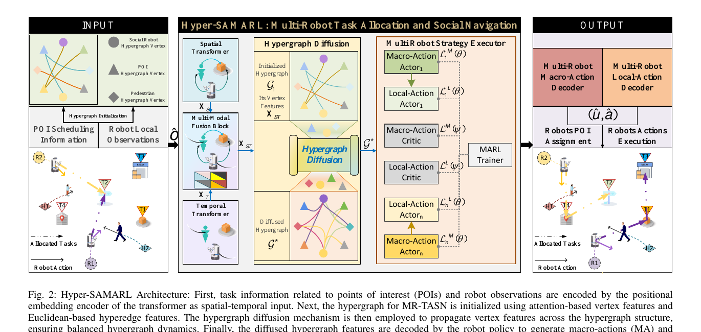
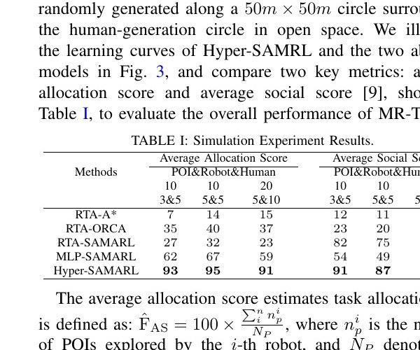
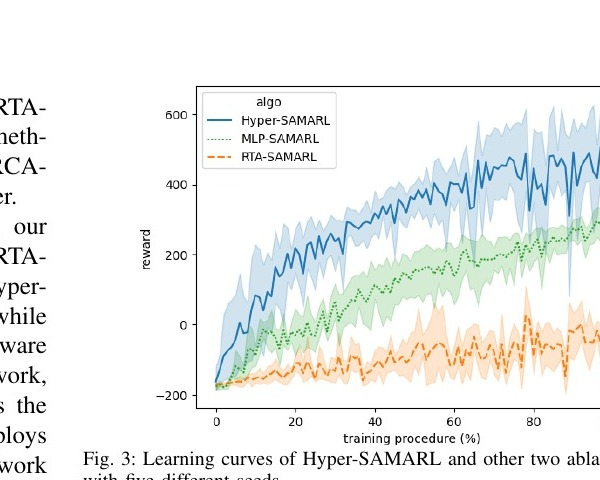

# Paper Review: Hyper-SAMARL

> **Paper:** Weizheng Wang, Aniket Bera, and Byung-Cheol Min, “Hypergraph-Based Coordinated Task Allocation and Socially-Aware Navigation for Multi-Robot Systems,” arXiv:2409.11561v2, 2025.  
> **Links:** [arXiv](https://arxiv.org/abs/2409.11561) · [Project page and videos](https://sites.google.com/view/hyper-samarl)

## Short verdict

Hyper-SAMARL is relevant to **General Interaction-Aware Goal Assignment** because it replaces isolated robot–task reasoning with a learned representation of higher-order relationships among robots, humans, and points of interest (POIs). It also trains assignment decisions from the quality of the downstream navigation that those decisions produce.

However, it does **not** solve our target problem directly. It studies dynamic task reassignment and learned social navigation in small, open-space, human-filled scenarios. Our initial problem is one-shot robot–goal assignment followed by a fixed planner, with emphasis on robot–robot path interaction, congestion, crossing, bottlenecks, scalability, and generalization.

> **Main takeaway:** retain Hyper-SAMARL’s collective relational representation and execution-informed objective, but test them in a cleaner one-shot assignment formulation with a fixed downstream planner and strong classical assignment baselines.

## 1. What is the paper studying?

The paper studies a coupled problem called multi-robot task allocation and socially-aware navigation (MR-TASN). The environment contains:

- multiple mobile robots;
- moving pedestrians;
- a set of POIs that must be visited.

The robots must repeatedly decide **which POIs to visit and in what order** while simultaneously selecting collision-avoiding, socially acceptable velocities. The authors model this as a decentralized partially observable semi-Markov decision process (Dec-POSMDP).

Hyper-SAMARL uses two action levels:

$$
\text{macro-action }u_{t_k}=\text{POI assignment/sequence},
$$

$$
\text{local action }a_t=[v_x,v_y]=\text{navigation command}.
$$

Macro-actions are updated at decision times $t_k$, while local velocity actions are executed between two macro decisions. Thus the paper is not only a task-allocation method and not only a navigation method; it jointly learns both.

**Figure 1 (cropped from Fig. 2 of the paper, p. 3).** Robot observations and POI information pass through spatial and temporal transformers. A hypergraph is initialized and diffused, and the resulting collective representation feeds both macro-action actors for POI assignment and local-action actors for navigation. This image shows the paper’s central contribution more clearly than a verbal description alone.

## 2. How does it relate to our research direction?

Our direction asks for an assignment model of the form

$$
A:(\mathcal R,\mathcal G,\mathcal E,\mathcal C)
\rightarrow \text{robot–goal assignment},
$$

where $\mathcal C$ represents collective interaction context. The objective is not merely short individual robot–goal distances, but good system behavior after assignment and planning:

$$
A^*=\arg\min_A J_{\mathrm{system}}
\big(A,\mathrm{Planner}(A),\mathcal E\big).
$$

Hyper-SAMARL follows the same broad philosophy. It represents robots, pedestrians, and POIs together, then lets downstream execution determine whether an assignment was good. It therefore supports two important claims behind our project:

1. assignment should depend on the collective context, not only independent robot–goal costs;
2. assignment quality should be judged by what happens during execution.

The exact problems still differ:

| Hyper-SAMARL | Our initial research problem |
|---|---|
| Dynamic POI assignment and reassignment | One-shot $N$-robot/$N$-goal assignment |
| Humans are a central source of interaction | Robot–robot and topology-induced interaction are central |
| Assignment and navigation are jointly learned | Assignment should first be isolated using a fixed planner |
| Continuous open-space simulation | MAPF plus continuous-space evaluation |
| 3–5 robots in reported tests | Must eventually scale and generalize to larger teams |

Hyper-SAMARL is therefore a **representation and formulation reference**, not yet a direct baseline solution for our one-shot benchmark.

## 3. What does Hyper-SAMARL change compared with ordinary assignment?

### 3.1 From a pairwise cost matrix to a collective state representation

Ordinary assignment commonly builds

$$
C=[c_{ij}],\qquad c_{ij}=d(r_i,g_j),
$$

and then solves a linear assignment problem. Each matrix entry evaluates one robot–goal pair independently.

Hyper-SAMARL instead creates vertices for robots, humans, and POIs. Its hyperedges can connect more than two entities, allowing a relation such as

$$
(r_1,r_2,h_1,g_3)
$$

to influence a decision jointly. This matters when a robot–goal pair appears attractive alone but becomes poor because another robot or a crowd occupies the same region.

### 3.2 Spatial and temporal context before assignment

Spatial and temporal transformers encode current relationships and their evolution. Assignment can therefore depend on positions, velocities, task locations, and changing interaction context rather than a static Euclidean distance alone.

### 3.3 Nonlinear hypergraph diffusion

The initialized hypergraph groups nearby entities and uses transformer features as vertex attributes. A nonlinear diffusion process repeatedly propagates information through the hypergraph. The final feature $G^*$ is a learned collective description used by both the assignment and navigation policies.

The reusable idea for our work is:

$$
\boxed{\text{construct a collective interaction representation before selecting the assignment.}}
$$

### 3.4 Assignment as a temporally extended macro-action

An ordinary solver outputs a matching once. Hyper-SAMARL’s macro-policy outputs POI assignments/sequences repeatedly as the environment changes. This gives adaptability, but it also means the paper does not isolate the one-shot assignment question.

### 3.5 Downstream execution trains the allocator

The macro-action reward is the discounted return accumulated from local navigation between macro-action updates:

$$
\hat R(\hat s,\hat u)
=
\mathbb E\!\left[
\sum_{t=0}^{T}\gamma^t
\hat R(\hat s_t,\hat a_t)
\mid \hat a_t\sim\hat u(H_t)
\right].
$$

The causal chain is therefore

$$
\text{assignment}
\rightarrow \text{navigation behavior}
\rightarrow \text{system reward}
\rightarrow \text{update the assignment policy}.
$$

This is the closest connection to our desired system-level assignment objective.

## 4. Their reward shows what “good assignment” means

For robot $i$, the local reward in Eq. (12) gives:

- **+100** when all robots finish their assigned POIs;
- **+25** when robot $i$ reaches a POI;
- **−100** for collision;
- **−100** for timeout while tasks remain;
- a proximity penalty, down to **−5**, when a robot comes within 0.45 m of a human;
- otherwise, goal-progress reward minus a time-efficiency penalty:

$$
\frac{1}{2}\Delta d_{i,g}-f_t(t).
$$

Therefore, in this paper a “good assignment” is one whose execution produces:

$$
\boxed{
\text{more completed POIs}
+\text{faster progress}
+\text{fewer collisions}
+\text{more comfortable human–robot separation}
}.
$$

This is substantially richer than minimizing $\sum_i d(r_i,g_i)$. It is also an important warning: the learned meaning of “good” is entirely determined by the reward. For our project, a reward or supervised target must explicitly reflect our intended collective behavior—executed makespan, total flowtime, waiting, conflicts, crossing, and congestion—not only completion and social distance.

## 5. What has this paper solved relative to our problem?

### 5.1 It demonstrates that higher-order relational encoding can help

The strongest evidence is the comparison between MLP-SAMARL and Hyper-SAMARL. Removing the hypergraph reduces the reported allocation scores from 93/95/91 to 62/67/59 and the social scores from 91/87/82 to 54/49/41 across the three configurations. Because other differences may remain inside the full learned system, this is evidence for the value of relational structure, not proof that hypergraphs are uniquely necessary.

**Figure 2 (cropped from Table I of the paper, p. 6).** Hyper-SAMARL obtains the best reported allocation and social scores in all three configurations: 3 robots/5 humans/10 POIs, 5/5/10, and 5/10/20. Each method was evaluated over 500 random scenarios.

### 5.2 It connects task assignment to downstream behavior

The assignment policy receives feedback from navigation outcomes rather than a hand-designed robot–goal distance matrix. This supplies a concrete learning mechanism for the manual’s system-level objective.

### 5.3 It integrates dynamic context into reassignment

The method can change assignments as pedestrians and environmental relationships change. This is useful for the later transition from one-shot assignment to lifelong or context-adaptive assignment.

### 5.4 It supplies a useful ablation pattern

The paper compares random task allocation with different planners, removes the learned allocator, and removes the hypergraph. That experimental structure is reusable: isolate the contribution of the allocator, representation, and downstream planner instead of reporting only a final end-to-end score.

**Figure 3 (cropped from Fig. 3 of the paper, p. 6).** Across five random seeds, Hyper-SAMARL reaches a higher training reward than the MLP and random-allocation ablations. The large variance also shows that training stability should be reported, not hidden behind a single run.

## 6. Limitations relative to our project

### 6.1 It does not isolate assignment quality

Hyper-SAMARL learns the allocator and navigator together. If performance improves, it is difficult to attribute the gain specifically to the assignment. Our first study should hold the planner fixed:

$$
A_1\rightarrow P,\qquad A_2\rightarrow P,\qquad A_3\rightarrow P.
$$

### 6.2 It is not one-shot goal assignment

The method repeatedly updates assignments and POI visit order. It therefore solves a more dynamic but different problem than a single permutation between $N$ robots and $N$ goals.

### 6.3 Its interaction focus is mainly robot–human

The paper does not directly study assignment-induced robot–robot crossing, opposing corridor traffic, bottleneck competition, or MAPF congestion—the interactions most important to our initial project.

### 6.4 The classical assignment baselines are weak for our question

The main allocator baseline is random task allocation. The paper does not compare against Euclidean Hungarian, shortest-path Hungarian, bottleneck assignment, optimal transport, or a search-based joint assignment/planning method under the same planner. It therefore does not quantify when a strong pairwise optimizer actually fails.

### 6.5 Scalability and generalization remain unproven

The largest reported team has only five robots. The paper does not establish performance for tens or hundreds of robots, unseen robot counts, new map topologies, or substantially different goal distributions.

### 6.6 The environment does not expose structured congestion

Testing occurs in a 50 m × 50 m open-space circular scenario with moving humans and static POIs. There are no warehouse aisles, narrow doors, corridors, or obstacle-induced traffic channels. These are precisely the cases where interaction-aware goal assignment may matter most.

### 6.7 The metrics do not match our complete objective

Allocation score is the percentage of POIs explored, while social score combines path time and uncomfortable robot–human interactions. The paper does not report executed makespan, sum of costs, conflict counts, accumulated waiting, bottleneck occupancy, assignment runtime, or large-team planning runtime.

### 6.8 Reward design can entangle objectives

Completion, collision avoidance, human comfort, navigation efficiency, and assignment quality are blended into one learned return. A high return does not reveal which component improved. Our experiments should report separate metrics and include controlled reward/objective ablations.

## 7. What we should take from this paper

### Idea to reuse: relational interaction encoding

Represent robots, goals, and possibly environment features as a set or graph rather than flattening them into independent cost entries. Candidate nodes are:

$$
\{r_1,\ldots,r_N,g_1,\ldots,g_N,b_1,\ldots,b_K\},
$$

where $b_k$ denotes a bottleneck, corridor, or other interaction-critical region. A hypergraph is one option, but a graph network or set transformer should remain valid alternatives until experiments justify the extra complexity.

### Formulation to reuse: judge assignments through execution

Use the same downstream planner to evaluate all assignments:

$$
\text{configuration}
\rightarrow A
\rightarrow \text{fixed planner }P
\rightarrow J_{\mathrm{system}}.
$$

A possible objective is

$$
J=
\lambda_M M
+\lambda_S SOC
+\lambda_C N_{\mathrm{conflict}}
+\lambda_W T_{\mathrm{wait}}
+\lambda_B C_{\mathrm{bottleneck}}.
$$

The weights should not replace reporting the individual metrics.

### Baselines to use

At minimum, compare:

1. Euclidean-distance Hungarian;
2. shortest-path-distance Hungarian;
3. bottleneck/makespan assignment such as OM;
4. random assignment as a lower reference;
5. interaction-aware model with and without its relational encoder;
6. an oracle or small-instance exhaustive search when computationally feasible.

Hyper-SAMARL itself is better treated as an **architectural reference** than a drop-in baseline because its task and action spaces differ substantially from one-shot goal assignment.

### Experimental setup to reuse and improve

Reuse its emphasis on multiple seeds, ablations, and varied numbers of entities, but add scenarios designed to expose assignment-induced interaction:

- random starts → formation goals;
- two-group region exchange;
- narrow-passage competition;
- opposing corridor traffic;
- dense cluster redistribution;
- unseen maps, robot counts, and goal distributions.

For every method, report assignment time, planning time, executed makespan, flowtime, conflicts, waiting, crossing, and success rate.

### Future hypothesis derived from the paper

$$
\boxed{
\begin{aligned}
&\text{Higher-order relationships among robots, goals, and environment topology}\\
&\text{predict downstream interaction better than independent pairwise distance,}\\
&\text{and can therefore produce better one-shot assignments under a fixed planner.}
\end{aligned}}
$$

This is testable and directly aligned with the manual. It is more precise than claiming that “hypergraphs improve assignment.”

## 8. Final assessment

| Question | Assessment |
|---|---|
| Does it go beyond independent robot–goal distance? | Yes |
| Does it encode higher-order interaction? | Yes, using a hypergraph |
| Does downstream execution influence assignment learning? | Yes |
| Does it support dynamic reassignment? | Yes |
| Is it one-shot $N$-robot/$N$-goal assignment? | No |
| Is assignment isolated from planning? | No |
| Does it target robot–robot congestion and crossings? | Not directly |
| Does it compare against strong classical matching baselines? | No |
| Does it demonstrate large-team scalability or size generalization? | No |
| Is the representation idea useful for our project? | Strongly yes |

Hyper-SAMARL has solved an important piece of our broader problem: it shows a workable way to encode higher-order environmental relations and let execution quality train the assignment layer. What remains open—and is central to our research—is whether such collective representations improve **clean one-shot robot–goal assignment**, specifically under robot–robot interaction and structured map congestion, while retaining scalability and generalization.

## Figure and reuse note

The three embedded images are cropped excerpts from the cited paper and are included for private academic commentary and analysis. Copyright remains with the authors or rights holder. If the repository becomes public or is used in a publication, verify the applicable reuse policy or replace the excerpts with original redrawn diagrams.

## Reference

W. Wang, A. Bera, and B.-C. Min, “Hypergraph-Based Coordinated Task Allocation and Socially-Aware Navigation for Multi-Robot Systems,” arXiv:2409.11561v2, 2025. [https://arxiv.org/abs/2409.11561](https://arxiv.org/abs/2409.11561)
